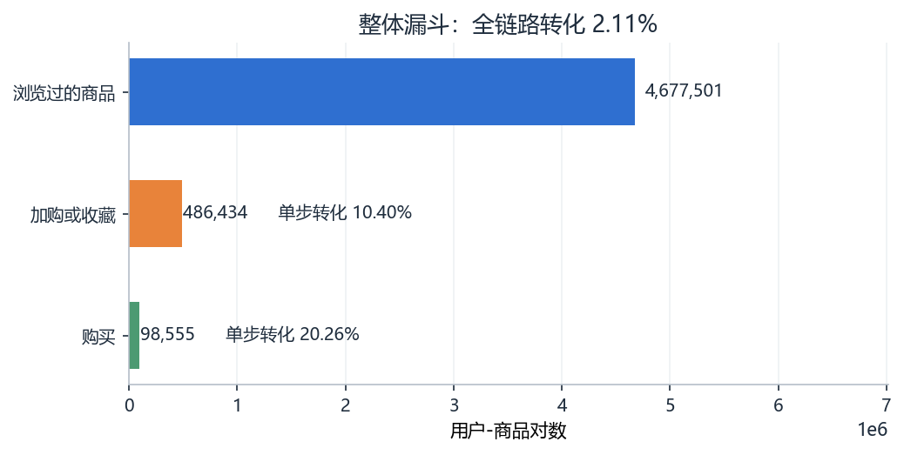
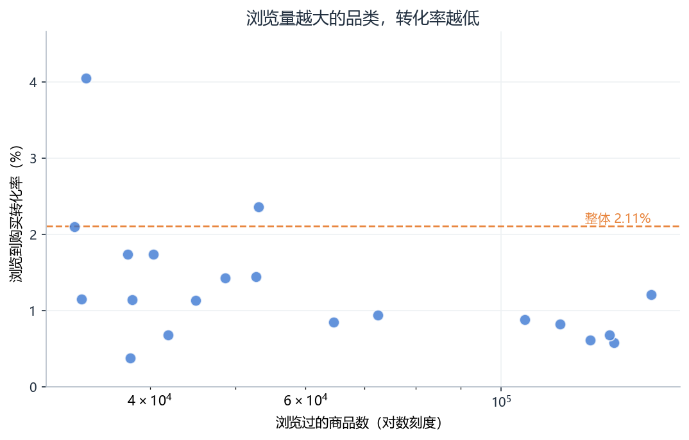
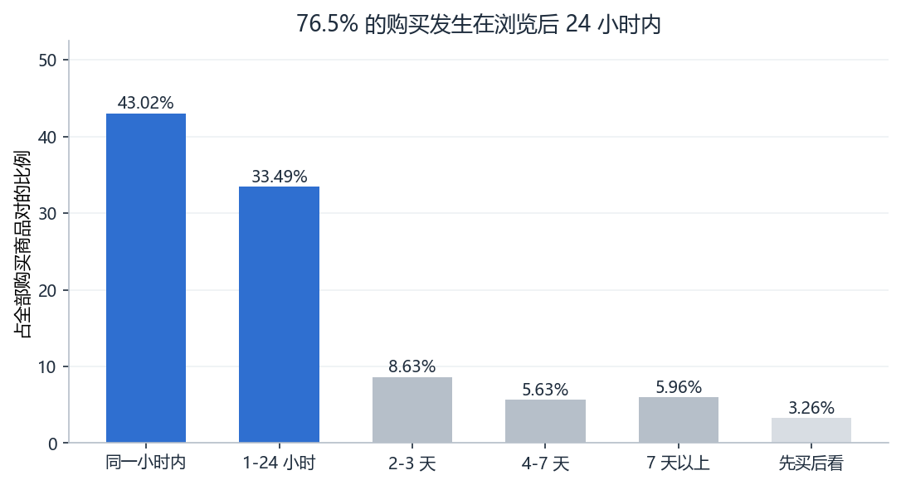
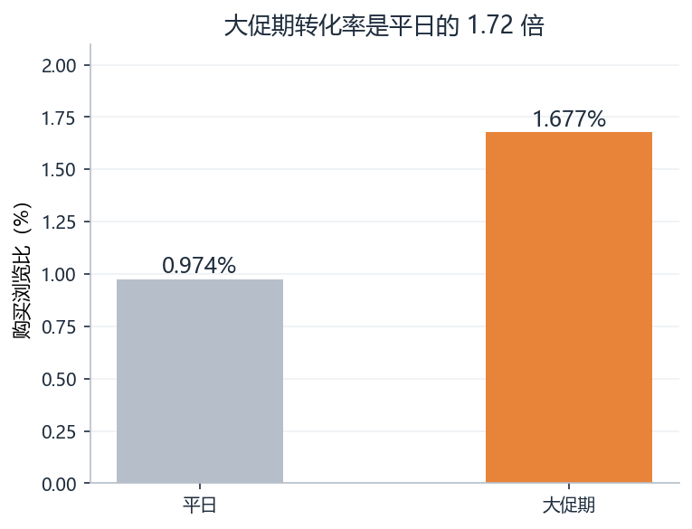
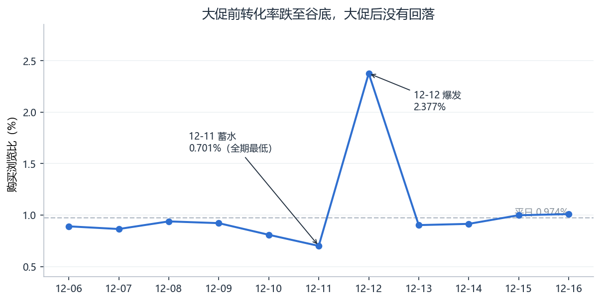
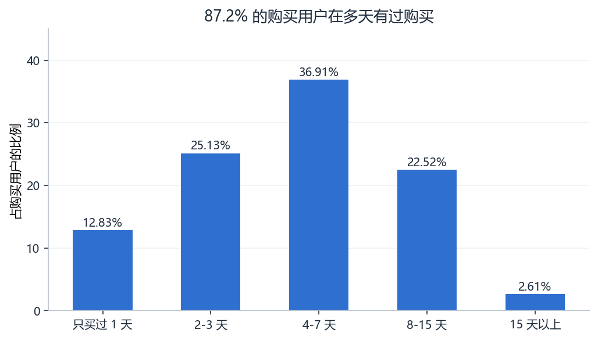

# 电商用户行为漏斗与转化分析

基于阿里云天池「移动推荐算法」数据集的完整分析项目：从 1,225 万条用户行为日志出发，
定位用户流失环节、识别值得投入的品类与时间窗口，最终输出一份结论先行的分析报告。

**技术栈**：MySQL 8.0 / SQL / Python（pandas、matplotlib）/ DataGrip

---

## 核心发现

| 发现 | 关键数字 |
| --- | --- |
| 整体漏斗健康，问题在局部而非全局 | 全链路转化率 **2.11%** |
| 浏览量越大的品类，转化率越低 | 前 20 大品类 **1.09%**，不足长尾品类（**2.54%**）的一半 |
| 购买决策高度集中在 24 小时内 | **76.5%**，其中 43.0% 在同一小时完成 |
| 大促带来的是高质量流量 | 大促转化率 **1.677%**，是平日（0.974%）的 **1.72 倍** |
| 大促前有蓄水，之后无需求透支 | 12-11 转化率跌至 **0.701%**，大促后回升至 0.956% |
| 用户复购基础强（受样本偏差影响） | 87.2% 的购买用户在多个日期有过购买 |

---

## 一个关键的方法调整

常规的**用户级**漏斗在这份数据上失效：算出来 **88.86% 的用户都购买过**，
指标饱和、完全没有区分度。

原因是这份数据人均行为高达 **1,226 条**，而购买事件占 0.98%，
意味着平均每个用户有约 12 次购买记录——"有没有买过"几乎是一个所有人都满足的条件。

改用**「用户-商品对」**粒度（把一个用户对一个商品的所有行为压缩成一行）之后，
转化率才回到合理区间：

| 环节 | 数量 | 单步转化率 |
| --- | --- | --- |
| 浏览过的商品 | 4,677,501 | — |
| 其中加购或收藏 | 486,434 | 10.40% |
| 其中购买 | 98,555 | 20.26% |
| 全链路 | — | **2.11%** |

---

## 数据

| 项目 | 值 |
| --- | --- |
| 来源 | 阿里天池「移动推荐算法」训练集 |
| 行为条数 | 12,256,906 |
| 用户 / 商品 / 品类 | 10,000 / 2,876,947 / 8,916 |
| 观察期 | 2014-11-18 至 2014-12-18，共 31 天，无缺失 |
| 行为分布 | pv 94.24% / cart 2.80% / fav 1.98% / buy 0.98% |

**两个必须说明的数据特点**

一是**样本偏差**。人均行为 1,226 条，而真实电商场景人均通常只有几十条，
说明数据集只保留了重度用户。因此本项目所有绝对水平都不能外推到全站，
只适用于观察结构差异和相对关系。

二是观察期内含**双十二大促**（12-11、12-12），行为量分别是平日的 1.22 倍和 1.71 倍，
涉及趋势的分析都单独处理了这两天。

> 原始数据文件 507 MB，未随仓库上传，可从阿里天池下载后放到
> `tianchi_mobile_recommend_train_user/` 目录下。

---

## 目录结构

```
├── sql/                    分析 SQL，按执行顺序编号
│   ├── 00_说明.md           执行说明与口径提醒
│   ├── 01_create_table.sql  建库建表
│   ├── 02_load_data.sql     LOAD DATA 导入 + 建索引
│   ├── 03_overview.sql      数据体检
│   ├── 04_funnel.sql        整体漏斗（含口径改造对照）
│   ├── 05_category.sql      品类拆解
│   ├── 06_time_gap.sql      决策时间窗
│   ├── 07_promo_vs_normal.sql  大促 vs 平日
│   ├── 08_promo_trend.sql   大促前后日趋势
│   └── 09_repurchase.sql    复购分布
├── charts.py               生成 6 张图表
├── figures/                图表输出
└── report.md               完整分析报告
```

---

## 复现步骤

1. **准备数据**：从天池下载 `tianchi_mobile_recommend_train_user.csv`，
   放到 `tianchi_mobile_recommend_train_user/` 目录
2. **建表**：在 DataGrip 里执行 `sql/01_create_table.sql`
3. **导入**：执行 `sql/02_load_data.sql`（需先勾选数据源的
   `allowLoadLocalInfile`，约几分钟，1200 万行）
4. **分析**：按编号依次执行 `sql/03` 到 `sql/09`
5. **出图**：`python charts.py`，图表输出到 `figures/`

---

## 图表

### 整体漏斗



### 各品类浏览量 vs 转化率



### 决策时间窗



### 大促 vs 平日



### 大促前后日趋势



### 复购分布



---

## 局限

1. 数据只保留重度用户，绝对水平不能外推
2. 只有品类 ID、没有品类名称，无法定位到具体商品
3. 没有金额字段，算不了 GMV 与客单价
4. 没有渠道与会话 ID，漏斗只能做到用户-商品对级别
5. 大促后仅观测 4 天，长期需求透支无法验证
6. 大促高转化、大品类低转化都缺少控制变量，只陈述相关关系

完整分析过程与结论见 [report.md](report.md)。
